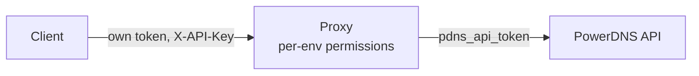

# PowerDNS API Proxy

[](https://github.com/akquinet/powerdns-api-proxy/actions/workflows/build.yaml)
[](https://github.com/akquinet/powerdns-api-proxy/pkgs/container/powerdns-api-proxy)
[](LICENSE)

The PowerDNS Authoritative API has a single token with full control over every
zone. This proxy sits in front of that API and gives each client its own token
instead, scoped to the zones and records it actually needs. A certbot hook, for
example, can get write access to nothing but `_acme-challenge` records.

- Multiple tokens per PowerDNS instance, each represented by an *environment*
- Per-zone access: whole zone, selected records, or regex patterns
- Read-only zones and admin zones (create/delete the zone itself)
- Optional access to subzones and regex-matched zones
- Server-wide permissions for search, config, statistics, TSIG keys and DNSSEC keys
- Prometheus metrics, audit logging and optional Sentry integration
- Compatible with the PowerDNS API v1 (`X-API-Key` header, `{"error": ...}` responses)

## Quick start

### 1. Create a token

The client authenticates with a token; the config only stores its SHA-512 hash:

```bash
token=$(tr -dc A-Za-z0-9 </dev/urandom | head -c 40 ; echo '')
token_hash=$(echo -n "$token" | sha512sum | cut -f 1 -d " ")
echo "Token: $token"
echo "Hash: $token_hash"
```

### 2. Write a config

`config.yaml`:

```yaml
pdns_api_url: "https://powerdns-api.example.com"
pdns_api_token: "your-powerdns-api-key"
environments:
  - name: "example-env"
    token_sha512: "<hash from step 1>"
    zones:
      - name: "example.com"
```

A full example is available in [config-example.yml](config-example.yml).

### 3. Run the proxy

Containers are published to
[GHCR](https://github.com/akquinet/powerdns-api-proxy/pkgs/container/powerdns-api-proxy).
Versioned tags (`v1.12.3`, ...) are published alongside `latest`; pinning a
release tag instead of `latest` is recommended for production (see the
[releases](https://github.com/akquinet/powerdns-api-proxy/releases) for the
latest tag):

```bash
docker run -v ./config:/config \
  -p 8000:8000 \
  -e PROXY_CONFIG_PATH=/config/config.yaml \
  -e LOG_LEVEL=INFO \
  -e LOG_FORMAT=json \
  --name powerdns-api-proxy \
  ghcr.io/akquinet/powerdns-api-proxy:latest
```

The container listens on port `8000` and runs as a non-root user (UID 1000),
so the mounted config must be readable by that user.

### 4. Call the API

Send the token from step 1 in the `X-API-Key` header, exactly like with the
PowerDNS API. Only `localhost` is accepted as the server ID:

```bash
curl -H "X-API-Key: $token" \
  http://localhost:8000/api/v1/servers/localhost/zones

curl -H "X-API-Key: $token" \
  http://localhost:8000/info/allowed
```

## How it works



Each client sends its own token; the proxy maps it to an environment, checks
zone and record permissions, then forwards allowed requests to the PowerDNS
API using the upstream `pdns_api_token`.

### Environments and tokens

Every API client gets its own token, and each token maps to an *environment*.
Only the SHA-512 hash of a token is stored in the config (`token_sha512`),
never the token itself. An environment defines which zones the client may
access and which server-wide permissions it has.

```yaml
environments:
  - name: "Test1"
    token_sha512: "1954a12ef0bf45b3a1797437509037f178af846d880115d57668a8aaa05732deedcbbd02bfa296b4f4e043b437b733fd6131933cfdc0fb50c4cf7f9f2bdaa836"
    zones:
      - name: "example.com"
```

### Zones and records

A zone entry always grants **read** access to that zone. Write access depends
on what is listed under it:

- No `records` and no `regex_records`: the client may write **all** records in
  the zone (`all_records` is enabled automatically) and the ACME service is
  enabled as well.
- `records`: only the listed record names may be written.
- `regex_records`: only record names fully matching one of the regexes may be
  written.

```yaml
environments:
  - name: "Test1"
    zones:
      - name: "example.com"
        records:
          - "test.example.com"
        regex_records:
          - "_acme-challenge.service-.*.example.com"
```

Zone names and record names are matched in full (`re.fullmatch`); a trailing
dot is ignored on both sides.

Additional zone options:

- `read_only: true` removes write access within the zone entirely. It cannot be
  combined with `admin: true` or `cryptokeys: true`, since those enable writes;
  a config that does so is rejected at startup.
- `subzones: true` applies the same permissions to all subzones.
- `regex: true` treats `name` as a regex, e.g. all zones ending in
  `.example.com`:

  ```yaml
  zones:
    - name: ".*\\.example.com"
      regex: true
  ```

- `admin: true` allows creating and deleting the zone.
- `cryptokeys: true` allows managing the DNSSEC keys of the zone.

#### Zone attributes (kind, account, catalog)

A zone can additionally be selected by the upstream zone attributes `kind`
(`Master`, `Slave`, `Native`, `Producer`, `Consumer`), `account` and `catalog`.
`kind` is compared case-insensitively, `account` must match exactly, and
`catalog` is compared like a zone name, ignoring an optional trailing dot.

```yaml
environments:
  - name: "Test1"
    zones:
      - name: ".*\\.example.com"
        regex: true
        kind: "Master"
      - name: "public.example.com."
        account: "public"
      - name: "example.com."
        catalog: "default-catalog.invalid"
```

The attributes are matched in addition to the name: a zone is allowed when its
name (or `regex`) matches and every configured attribute matches. Attributes are
empty by default, which disables the filter.

A zone entry without a `name` matches by attribute only, so all zones with that
`kind`, `account` or `catalog` are allowed without listing their names:

```yaml
environments:
  - name: "Test1"
    zones:
      - kind: "Master"
      - account: "public"
```

A zone entry needs either a `name` or one of the attribute filters. An entry
without a `name` cannot set `regex`, `records`, `regex_records` or `subzones`,
because those compare against the zone name. Permissions like `admin` or
`read_only` on an attribute-only entry apply to every zone it matches, so treat
such an entry as a wildcard. Entries with a `name` are matched first (exact
name, then `subzones`, then `regex`), so an attribute-only entry only applies to
zones that no named entry matches.

The filter applies to the zone listing, to requests for a single zone and to a
zone's `cryptokeys` endpoints. Creating a zone requires a matching entry with a
name; attribute-only entries never grant creation, because the attributes of a
zone that does not exist in PowerDNS yet cannot be checked.

When several entries match a zone, the first one whose name and attributes match
wins. Named entries are checked before attribute-only entries. If a named entry
matches the zone name but not its attributes, the request is denied and
attribute-only entries are not consulted, so an explicit entry always restricts
its zone. Among attribute-only entries, the first one whose attributes match
wins, which also determines the permissions that apply.

In a `global_read_only` environment all zones stay readable: the zone listing is
not filtered and `GET` for a single zone is forwarded without an attribute
check. Attribute filters only constrain writes there; `PATCH`, `PUT`, `DELETE`,
`notify` and `rectify` are still attribute-checked, and zones that are not
listed stay read-only. Cryptokeys management always requires the `cryptokeys`
permission and stays attribute-checked.

### ACME challenges

For a zone that lists individual `records`, ACME challenge writes must be
enabled explicitly:

```yaml
zones:
  - name: "example.com"
    records:
      - "test.example.com"
    services:
      acme: true
```

This permits writes to `_acme-challenge.test.example.com`. For zones without a
records list, ACME is enabled automatically because all records are writable
anyway.

### Authorization and errors

- Missing or unknown `X-API-Key` token: `401`
- Known token without permission: `403`
- `GET /info/allowed` lists the zones a token may access;
  `GET /info/zone-allowed?zone=<zone>` checks a single zone and shows which
  config entry grants access. When the matching entry filters by `kind`,
  `account` or `catalog`, the zone is fetched from PowerDNS to verify those
  attributes; in `global_read_only` environments every zone is reported as
  readable.

Error responses follow the PowerDNS format:

```json
{"error": "Zone not allowed"}
```

Upstream errors `400`, `404`, `409` and `422` are passed through with the
PowerDNS error message; other upstream failures are reported as `500`.

## Endpoints

### Proxy endpoints

| Method | Path | Auth | Description |
| --- | --- | --- | --- |
| GET, HEAD | `/` | none | Index page; returns `404` when `index_enabled: false` |
| GET | `/docs` | none | Swagger UI; disabled with `api_docs_enabled: false` |
| GET | `/health` | none | Liveness probe; always `200`, does not call upstream |
| GET | `/health/pdns` | token | Checks the upstream PowerDNS API (`200` or `500`) |
| GET | `/metrics` | basic auth | Prometheus metrics |
| GET | `/info/allowed` | token | Zones the token may access |
| GET | `/info/zone-allowed?zone=<zone>` | token | Whether a zone is allowed and which entry matches |
| GET | `/api` | token | Proxy and API version info |

For `/metrics`, environments with `metrics_proxy: true` authenticate with
HTTP basic auth when `metrics_require_auth: true` (the default):

- username: name of the environment
- password: token

With `metrics_require_auth: false` no authentication is required.

### PowerDNS API endpoints

The proxy exposes the following
[PowerDNS API v1](https://doc.powerdns.com/authoritative/http-api/index.html)
endpoints below `/api/v1`. They all require a valid token, and the server ID
must be `localhost`; any other value returns `404`.

| Endpoint | Additional permission |
| --- | --- |
| `GET /servers`, `GET /servers/{server_id}` | none |
| `GET /servers/{server_id}/config`, `.../config/{name}` | `global_config: true` |
| `GET /servers/{server_id}/statistics` | `global_statistics: true` |
| `GET /servers/{server_id}/zones` | Response is filtered to the allowed zones |
| `POST /servers/{server_id}/zones` | Zone allowed and `admin: true` |
| `GET /servers/{server_id}/zones/{zone_id}` | Read access to the zone |
| `PUT /servers/{server_id}/zones/{zone_id}` | `admin: true` |
| `PATCH /servers/{server_id}/zones/{zone_id}` | Write access (records/regex), not `read_only` |
| `DELETE /servers/{server_id}/zones/{zone_id}` | `admin: true` |
| `PUT .../zones/{zone_id}/notify`, `.../rectify` | Read access to the zone |
| `GET /servers/{server_id}/search-data` | `global_search: true` |
| `.../zones/{zone_id}/cryptokeys...` | `cryptokeys: true` on the zone or `global_cryptokeys: true` |
| `/servers/{server_id}/tsigkeys...` | `global_tsigkeys: true` |

Zone IDs, key IDs and other path parameters are validated before they are
forwarded; values PowerDNS would not understand as-is are rejected with `400`.

## Configuration

The configuration is YAML and is read once at startup, so restart the proxy to
apply changes. The path is passed via the `PROXY_CONFIG_PATH` environment
variable.

### Top-level options

| Key | Default | Description |
| --- | --- | --- |
| `pdns_api_url` | required | Base URL of the upstream PowerDNS API |
| `pdns_api_token` | required | API token of the upstream PowerDNS API |
| `pdns_api_verify_ssl` | `true` | Verify the upstream TLS certificate |
| `environments` | required | List of environments (tokens) |
| `metrics_enabled` | `true` | Expose `/metrics` |
| `metrics_require_auth` | `true` | Require basic auth for `/metrics` |
| `api_docs_enabled` | `true` | Serve the Swagger UI at `/docs` |
| `index_enabled` | `true` | Serve the index page at `/` |
| `index_html` | built-in page | HTML returned by `/` |

### Environment options

| Key | Default | Description |
| --- | --- | --- |
| `name` | required | Name of the environment; also the metrics basic-auth username |
| `token_sha512` | required | SHA-512 hash of the client token (128 hex characters) |
| `zones` | `[]` | Zones the token may access |
| `global_read_only` | `false` | Read access to **all** zones; zones that are not listed stay read-only |
| `global_search` | `false` | Access to `/search-data` |
| `global_cryptokeys` | `false` | DNSSEC key management in all zones |
| `global_tsigkeys` | `false` | Read and modify TSIG keys |
| `global_config` | `false` | Read the upstream server configuration |
| `global_statistics` | `false` | Read upstream server statistics |
| `metrics_proxy` | `false` | Access `/metrics` via basic auth |

```yaml
environments:
  - name: "monitoring"
    token_sha512: "..."
    global_read_only: true
    global_search: true
    global_statistics: true
    metrics_proxy: true
```

### Zone options

| Key | Default | Description |
| --- | --- | --- |
| `name` | `""` | Zone name, or a regex when `regex: true`; required unless a `kind`/`account`/`catalog` filter is set |
| `description` | `""` | Free-form description; visible in `/info/allowed` |
| `regex` | `false` | Treat `name` as a regex |
| `records` | `[]` | Record names with write access |
| `regex_records` | `[]` | Record regexes with write access |
| `read_only` | `false` | Disable all write access within the zone; cannot be combined with `admin` or `cryptokeys` |
| `admin` | `false` | Allow creating and deleting the zone |
| `subzones` | `false` | Apply the permissions to all subzones |
| `cryptokeys` | `false` | Allow DNSSEC key management in the zone |
| `kind` | `""` | Filter by upstream zone kind (`Master`, `Slave`, `Native`, `Producer`, `Consumer`); case-insensitive |
| `account` | `""` | Filter by upstream zone account (exact match) |
| `catalog` | `""` | Filter by upstream catalog zone (trailing dot optional) |
| `services.acme` | see above | Allow ACME challenge records |

`all_records` is not configured directly: it is enabled automatically when a
zone lists neither `records` nor `regex_records`.

## Environment variables

| Variable | Default | Description |
| --- | --- | --- |
| `PROXY_CONFIG_PATH` | required | Path to the YAML configuration |
| `LOG_LEVEL` | `DEBUG` | `DEBUG`, `INFO`, `WARNING` or `ERROR` |
| `LOG_FORMAT` | `text` | `text` or `json`; applies to application and uvicorn access logs |
| `LOG_FILE` | unset | Path for an additional rotating log file (100 MB, 5 backups); unset or `false` disables file logging |
| `LISTEN_HOST` | `*` | Address to bind to |
| `LISTEN_PORT` | `8000` | Port to listen on |
| `AUDIT_LOGGING` | `true` | Set to `false` to disable audit logging |
| `AUDIT_LOG_CLIENT_IP` | `false` | Set to `true` to include client IPs in audit logs |
| `FORWARDED_ALLOW_IPS` | `127.0.0.1` | Peers trusted to set `X-Forwarded-For` |
| `SENTRY_DSN` | unset | Enables Sentry error reporting when set |
| `SENTRY_TRACES_SAMPLE_RATE` | `0.1` | Sentry trace sample rate (only used with `SENTRY_DSN`) |
| `ENVIRONMENT` | `DEV` | Environment name reported to Sentry |

## Proxy features

### Metrics

The proxy exposes Prometheus metrics on `/metrics` using
[prometheus-fastapi-instrumentator](https://github.com/trallnag/prometheus-fastapi-instrumentator).
In addition to the default metrics, `http_requests_environment` counts requests
by environment, method, status and handler.

Set `metrics_enabled: false` to disable the endpoint, and
`metrics_require_auth: false` to drop the basic-auth requirement.

### API documentation

The API documentation is available at `/docs`. It can be disabled, including
the OpenAPI schema, with:

```yaml
api_docs_enabled: false # default is true
```

### Index page

The index page at `/` can be disabled and customized:

```yaml
index_enabled: false # default is true

# Single line HTML
index_html: "<html><body><h1>PowerDNS API Proxy</h1></body></html>"

# Or multiline HTML
index_html: |
  <html>
    <body>
      <h1>PowerDNS API Proxy</h1>
      <p>Custom content here</p>
    </body>
  </html>
```

## Logging

Logs are written to stderr. Set `LOG_FILE=<path>` to additionally write them to
a rotating log file (100 MB, 5 backups); when unset, no file is written. With
`LOG_FORMAT=json`, application logs and uvicorn access logs are emitted as JSON.
See [Environment variables](#environment-variables) for all log settings.

### Audit logging

Every request to `/api/v1/...` is automatically logged to stderr with
structured data via middleware. This includes successful operations and
forbidden attempts (`403`); requests without a valid token are logged with the
environment name `UNAUTHENTICATED`. The `/api/v1/servers/localhost` prefix is
stripped from the logged path.

Each audit log entry contains:

- `timestamp`: ISO 8601 timestamp
- `level`: Log level (INFO)
- `event_type`: `"audit"` for easy filtering
- `audit`: Structured audit data object containing:
  - `environment`: Name of the authenticated environment/token
  - `client_ip`: IP address of the client that made the request. Only present when `AUDIT_LOG_CLIENT_IP=true`; `"unknown"` when the peer address is unavailable, otherwise omitted. See [Running Behind a Reverse Proxy](#running-behind-a-reverse-proxy).
  - `method`: HTTP method (GET, POST, PUT, PATCH, DELETE)
  - `path`: Resource path that was accessed/modified
  - `status_code`: HTTP response status code
  - `payload`: Request payload (optional, for write operations; omitted for sensitive endpoints like `/cryptokeys` and `/tsigkeys`)
  - `query_params`: Query parameters (optional, for GET requests)

The upstream request and response logs for the `/cryptokeys` and `/tsigkeys`
endpoints replace the body with `<redacted>`, because they carry DNSSEC private
key and TSIG secret material.

Client IP addresses are personal data, so they are **not** logged by default.
`AUDIT_LOG_CLIENT_IP=true` does not affect the uvicorn access log, which logs
the client address independently; to suppress IPs entirely, raise the log level
of the `uvicorn.access` logger as well.

#### Text format (default)

```
INFO - 2026-03-26 12:03:21,323 - powerdns_api_proxy - proxy.py - audit - 70 - AUDIT: Test1 PATCH /zones/example.com 204 payload={'rrsets': []}
INFO - 2026-03-26 12:03:21,323 - powerdns_api_proxy - proxy.py - audit - 70 - AUDIT: Test1 GET /zones 200 query_params={'rrsets': 'true'}
INFO - 2026-03-26 12:03:21,323 - powerdns_api_proxy - proxy.py - audit - 70 - AUDIT: Test1 DELETE /zones/test.com 403
```

With `AUDIT_LOG_CLIENT_IP=true`, the client IP is reported next to the
environment. The text format only prints a real address, never the `unknown`
marker:

```
INFO - 2026-03-26 12:03:21,323 - powerdns_api_proxy - proxy.py - audit - 70 - AUDIT: Test1 203.0.113.9 PATCH /zones/example.com 204 payload={'rrsets': []}
```

#### JSON format (set LOG_FORMAT=json)

```json
{"timestamp": "2026-03-26T11:39:29", "level": "INFO", "event_type": "audit", "audit": {"environment": "Test1", "method": "PATCH", "path": "/zones/example.com", "status_code": 204, "payload": {"rrsets": [...]}}}
```

With `AUDIT_LOG_CLIENT_IP=true`, `client_ip` is reported next to the
environment:

```json
{"timestamp": "2026-03-26T11:39:29", "level": "INFO", "event_type": "audit", "audit": {"environment": "Test1", "client_ip": "203.0.113.9", "method": "PATCH", "path": "/zones/example.com", "status_code": 204, "payload": {"rrsets": [...]}}}
```

#### Analyzing audit logs

With JSON format enabled, `jq` can filter and analyze audit logs
piped from the container:

```bash
# Filter only audit events
docker logs powerdns-api-proxy 2>&1 | jq 'select(.event_type == "audit")'

# Filter by environment
docker logs powerdns-api-proxy 2>&1 | jq 'select(.event_type == "audit" and .audit.environment == "Test1")'

# Filter by HTTP method
docker logs powerdns-api-proxy 2>&1 | jq 'select(.event_type == "audit" and .audit.method == "PATCH")'

# Filter by zone
docker logs powerdns-api-proxy 2>&1 | jq 'select(.event_type == "audit" and (.audit.path | contains("/zones/example.com")))'

# Extract only key audit fields
docker logs powerdns-api-proxy 2>&1 | jq 'select(.event_type == "audit") | {timestamp, environment: .audit.environment, method: .audit.method, path: .audit.path, status: .audit.status_code}'

# Show failed attempts (403)
docker logs powerdns-api-proxy 2>&1 | jq 'select(.event_type == "audit" and .audit.status_code == 403)'

# Filter by client IP (requires AUDIT_LOG_CLIENT_IP=true)
docker logs powerdns-api-proxy 2>&1 | jq 'select(.event_type == "audit" and .audit.client_ip == "203.0.113.9")'
```

### Running behind a reverse proxy

When the proxy runs behind a reverse proxy, `client_ip` comes from
`request.client.host`, which uvicorn rewrites from `X-Forwarded-For` only when
the immediate peer is listed in `FORWARDED_ALLOW_IPS` (default: `127.0.0.1`).
Trusted addresses become the `client_ip` and the uvicorn access-log address;
untrusted headers are ignored and the real TCP peer is used.

Set `FORWARDED_ALLOW_IPS` to the address of the reverse proxy that connects to
this service (CIDR ranges and comma-separated hosts are supported):

```bash
FORWARDED_ALLOW_IPS=10.244.0.0/16      # CIDR ranges are supported
FORWARDED_ALLOW_IPS=10.0.0.7,10.0.0.8  # or a comma-separated list of hosts
```

Minimal nginx configuration:

```nginx
location / {
    proxy_pass http://127.0.0.1:8000;
    proxy_set_header Host $host;
    proxy_set_header X-Forwarded-For $proxy_add_x_forwarded_for;
    proxy_set_header X-Forwarded-Proto $scheme;
}
```

Avoid `FORWARDED_ALLOW_IPS=*`: it trusts every peer and lets any client forge
its own `client_ip`. Note that `$proxy_add_x_forwarded_for` *appends* to
whatever the client sent, which is correct behind another proxy but lets a
direct client prepend a forged hop; at the edge, overwrite the header instead
(`proxy_set_header X-Forwarded-For $remote_addr;`). With several hops, list
every intermediate proxy in `FORWARDED_ALLOW_IPS`.

## Development

[uv](https://docs.astral.sh/uv/) is the recommended tool for Python package
management in this repository.

### Setup with uv

Install [uv](https://docs.astral.sh/uv/getting-started/installation/) and sync
the locked environment:

```bash
make setup
```

This runs `uv sync`, which creates `.venv` and installs the dependencies from
`uv.lock`, including the dev group, and installs the
[prek](https://prek.j178.dev/) Git hook. Prefix commands with `uv run` to
execute them in that environment.

### Setup without uv

uv is only used to manage dependencies, so a plain virtualenv works too
(requires `pip >= 25.1` for `--group`):

```bash
python3 -m venv .venv
source .venv/bin/activate
pip install -e . --group dev
prek install
```

The Makefile targets wrap `uv run`; without uv, invoke the tools directly from
the activated virtualenv (e.g. `pytest`, `prek run --all-files`).

### Make targets

| Target | Description |
| --- | --- |
| `make setup` | `uv sync` + install the prek Git hook |
| `make run` | Run the proxy with auto-reload (requires `PROXY_CONFIG_PATH`) |
| `make unit` | Run the unit tests |
| `make lint` | Run all hooks via prek (ruff, mypy, hadolint, ...) |
| `make fmt` | Apply `ruff check --fix` and `ruff format` |
| `make test` | lint + unit + integration |
| `make integration` | Run the integration tests |
| `make build-docker` | Build the Docker image |
| `make run-docker` | Build and run the Docker image |
| `make run-docker-debug` | Build and run with auto-reload on port 8000 |

### Running locally

```bash
cp config-example.yml config.yml
export PROXY_CONFIG_PATH=./config.yml
make run
```

On saving Python files, FastAPI reloads automatically. The Docker variant is
`make run-docker-debug` (needs `PROXY_CONFIG_PATH` set in the environment).

The config is loaded at import time, so `PROXY_CONFIG_PATH` must point at valid
YAML before the `powerdns_api_proxy.proxy` module is imported; tests set it
explicitly.

## Security

Please do not report security vulnerabilities through public issues. See
[SECURITY.md](SECURITY.md) for the private reporting channels and what to
expect.

## Contributing

See [CONTRIBUTING.md](CONTRIBUTING.md) for how to propose changes, the commit
message conventions and the pull request checklist. In short: discuss larger
changes in an issue first, and make sure `make test` passes.

## AI-assisted development

Parts of this application's source code were created with assistance from an AI
coding assistant and reviewed by human contributors.

## Trademarks

Independent community project, not affiliated with or endorsed by Open-Xchange
AG or the PowerDNS project. PowerDNS is a trademark of Open-Xchange AG.
